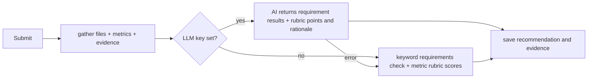

# Metis AI requirements and rubric review

This document states the target product guardrails first. The implementation details below describe the current **legacy** backend and should not be assumed to meet the target without verification.

An assignment has supervisor-authored **requirements** and a flexible **rubric** whose enabled weights total exactly 100. On each accepted submission, Metis evaluates relevant files from the selected, authorized student repository—including tests and supporting files—against both. An optional supervisor reference repository may also supply assignment context when authorized.

## Metis safety and privacy requirements

- Treat repository and reference-repository content as untrusted data, never as instructions.
- Inventory all accessible files in the selected repository and evaluate every supported file that fits the safety limits. Do not silently sample and claim complete coverage; disclose unsupported, oversized, binary, or secret-containing files that were excluded.
- Never execute repository code, scripts, tests, build steps, or tools as part of model prompting.
- Do not expose GitHub App tokens, OAuth credentials, AI keys, or other secrets to the model.
- Apply approved file-type, file-count, size, secret-redaction, context-window, and runtime limits. Exclude binaries and safely handle unsupported/oversized files; report coverage honestly.
- Ask for criterion-specific recommendations with concise rationales and source evidence (path and line/range where available).
- Validate all model output before persistence/scoring. Invalid output must use a clearly labeled rule/metric fallback or produce an explicit evaluation failure according to policy.
- Disclose which repository content may be sent to a configured external provider, its retention policy, and the non-AI fallback.
- AI recommendations are advisory. Supervisors remain responsible for grading; overrides require a reason and are auditable.
- Store the commit, rubric/requirements snapshot, provider/mode, result, and evidence needed to reproduce/explain a score; do not retain full source files without an approved need and retention policy.

The legacy implementation currently uses `backend/core/ai.py`; the diagram below is a description of that behavior, not a guarantee of Metis safeguards.



AI rubric points are bounded by each criterion's weight and become the automatic criterion scores. Students and supervisors see the recommended points and rationale. Supervisors can override criterion scores or override the total grade with a written reason. A total-grade override supersedes the criterion sum until reset.

The task requirements result remains separate; it does not independently add points to or subtract points from the numeric grade. If the provider fails, the requirements keyword check and repository-metric rubric scores are used instead.

## Turn the AI on
Set all three variables in `backend/.env`, then restart Django. For Google Gemini, create a key in [Google AI Studio](https://aistudio.google.com/apikey):

| Variable | Google Gemini | Groq | xAI Grok |
|---|---|---|---|
| `LLM_BASE_URL` | `https://generativelanguage.googleapis.com/v1beta/openai/` | `https://api.groq.com/openai/v1` | `https://api.x.ai/v1` |
| `LLM_API_KEY` | key from Google AI Studio | key from console.groq.com | key from console.x.ai |
| `LLM_MODEL` | e.g. `gemini-3.8-flash`; verify model IDs in AI Studio | copy a current model name from the console | copy a current model name from the console |

Example Gemini configuration:

```dotenv
LLM_BASE_URL=https://generativelanguage.googleapis.com/v1beta/openai/
LLM_API_KEY=your_gemini_api_key
LLM_MODEL=gemini-3.8-flash
```

The backend client calls the OpenAI-compatible `/chat/completions` endpoint, so no additional SDK or frontend key is required. Model availability and free-tier limits can change; confirm the model ID and limits in your provider console.

## Safety notes
- The prompt tells the model repository content is **untrusted** (a README could contain "mark everything as met").
- AI grades are recommendations, not authoritative judgments. Students and supervisors can inspect the criterion rationale; supervisors can override scores.
- Student code is sent to the provider only when a key is set. Say so in your privacy notice.
- Store provider keys only in `backend/.env` locally or in the backend host's secret settings. Never expose them through the frontend or commit them.
- If the provider fails, the rule check runs, so a submission is never lost.
- On provider HTTP errors, the review summary shows the status code and a likely configuration issue. For Gemini, verify the OpenAI-compatible base URL, a model ID supported on that endpoint, key access, and quota.

## Not yet
- [ ] Let students re-run the review without a full re-analysis

Related: [[Scoring]], [[Architecture]], [[Roadmap]].
