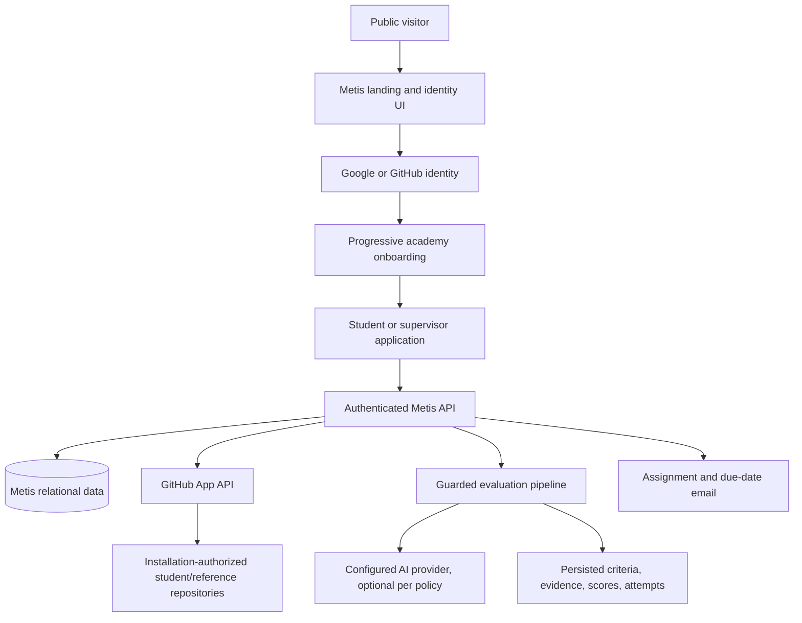
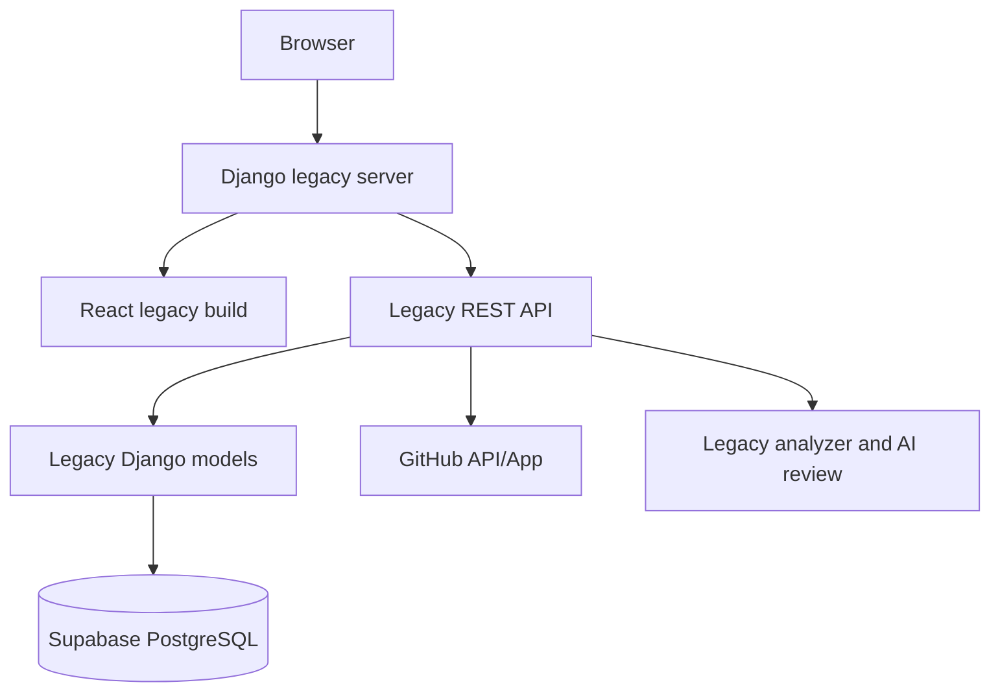

# Metis architecture

This document describes the target direction for the Metis rebuild. The current backend/frontend diagram below is a **legacy implementation reference**, not a commitment to retain the same architecture.

## Product boundary



### Trust boundaries

- Google/GitHub identity provider proves control of an identity; academy policy separately determines enrollment and supervisor permissions.
- Linking a Google account to GitHub must prove control of both identities. Matching email alone must not silently merge accounts.
- A linked GitHub user must authorize/install the Metis GitHub App before student enrollment/assignment participation.
- The backend fetches repository choices from the active App installation. Public visibility is not an authorization bypass; no manually entered student repository URL is accepted.
- A supervisor may attach an optional reference repository fetched from their authorized installation. The backend mediates read-only student access for that assignment.
- Repository file content is untrusted. Never execute submitted code, follow repository instructions, or expose App/provider credentials to the browser or AI context.
- AI recommendations and metric fallbacks are evidence-bearing advice; the supervisor controls final grades and records a reason for overrides.

## Core request: student submits an assignment

```mermaid
sequenceDiagram
  participant S as Student browser
  participant API as Metis API
  participant DB as Metis database
  participant GH as GitHub App API
  participant AI as AI provider
  S->>API: Load assignment and eligible repositories (authenticated)
  API->>DB: Verify academy enrollment and remaining attempts
  API->>GH: Fetch/refresh authorized installation repositories
  GH-->>API: Repository IDs/names granted to installation
  API-->>S: Assignment, materials, attempt limit, repository choices
  S->>API: Submit selected repository for assignment
  API->>DB: Atomically validate deadline and allocate attempt
  API->>GH: Read selected repo at submitted commit
  GH-->>API: Accessible files, tests, metadata
  API->>API: Apply file/secret/size guardrails; gather evidence
  opt AI permitted and configured
    API->>AI: Assignment criteria + bounded untrusted repository context
    AI-->>API: Validated recommendation and evidence references
  end
  API->>DB: Persist attempt, criteria snapshot, results, provenance
  API-->>S: Attempt status and result or explicit failure
```

## Target domain areas

- Identity and academy policy: provider accounts, matric number, student strengths, school-email verification, role assignment.
- Course and enrollment: academy ownership, enrollment states, authorization.
- Assignments: instructions, requirements, due time, optional reference material, rubric and maximum submissions.
- GitHub: user-bound App installation, repository sync, selected assignment repository, supervisor reference repository.
- Submission/evaluation: atomic attempt allocation, repository commit, criteria snapshot, evidence, results, overrides.
- Notifications: assignment events, 24h/5h reminder schedule, student preferences, idempotency and delivery status.

See [PRD.md](../PRD.md) for requirements and open decisions and [Data-Model.md](Data-Model.md) for entity contracts.

## Current legacy implementation

The existing code uses Django REST Framework, React/Vite, Supabase PostgreSQL, JWT, and a GitHub App. Current entry points include `backend/core/models.py`, `backend/core/views.py`, and `frontend/src`. Existing behavior includes separate project registration and legacy account auth; it does not yet satisfy the Metis target. Keep it available for inspection, but do not treat it as the final design.



The legacy Supabase schema is locked by `supabase/schema.sql`; see [Supabase-Security.md](Supabase-Security.md). Reassess storage/auth choices for Metis before reusing them.
