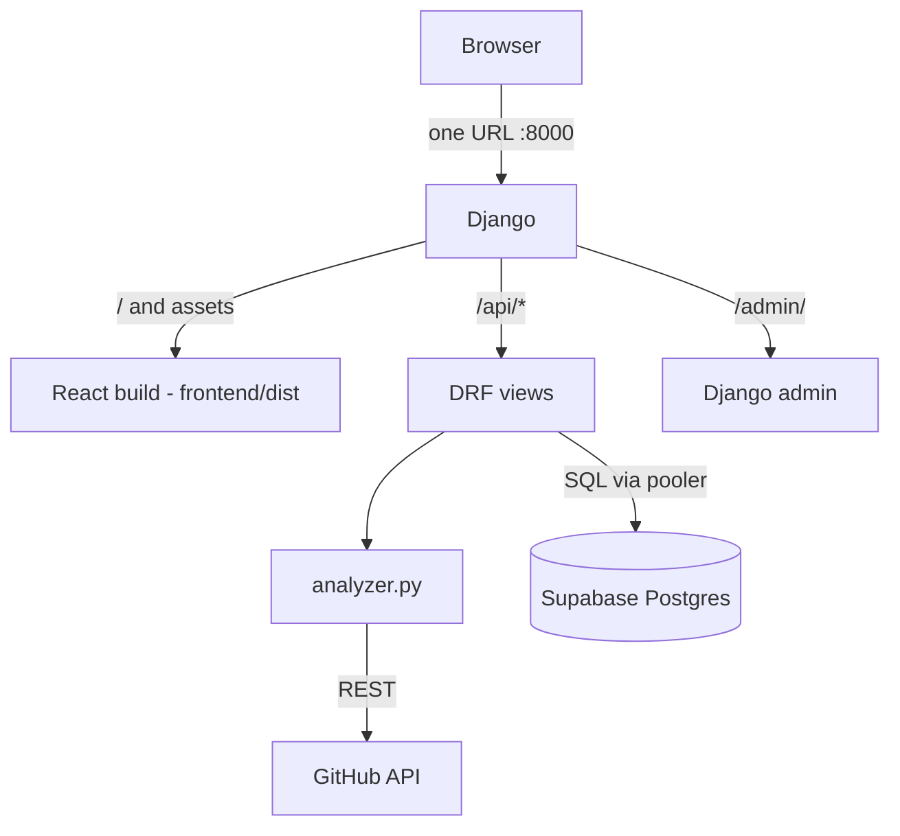
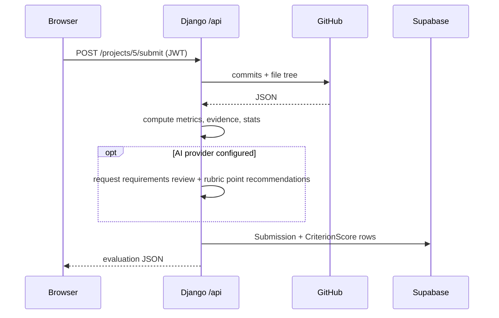

# Architecture

## Request: student submits a repo

## Folders
| Path | What |
|---|---|
| `backend/core/models.py` | tables - see [[Data-Model]] |
| `backend/core/analyzer.py` | GitHub -> metrics - see [[Scoring]] |
| `backend/core/views.py` | every endpoint |
| `frontend/src/pages` | screens |
| `supabase/schema.sql` | security rules - see [[Supabase-Security]] |

Auth: JWT from `/api/auth/login`, stored in `localStorage`, sent as `Authorization: Bearer`.
