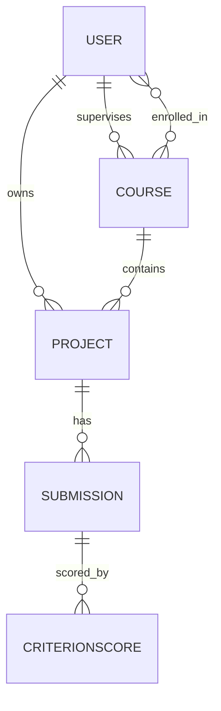

# Data model

| Table | Notes |
|---|---|
| `core_user` | role = student / supervisor, matric, department |
| `core_course` | `join_code`, `rubric` (JSON list of name/metric/weight) |
| `core_project` | `repo` as owner/name |
| `core_submission` | `metrics`, `evidence`, AI requirements/rubric review, optional overall override + reason, `status` done/failed |
| `core_criterionscore` | `auto`, `override`, `reason` |

Back to [[Architecture]].
