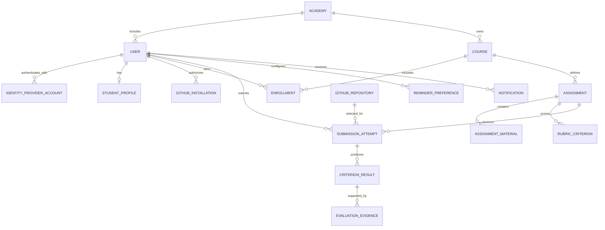

# Metis data model

This is the **target logical model** for the rebuild, not a description of current database tables. The current Django schema is a legacy reference below. Use migrations and preserve historical data; do not copy this conceptual model into a live database without a migration plan.

## Target entity relationships



## Target entities and invariants

| Entity | Important fields/relationships | Invariants |
|---|---|---|
| `Academy` | Name, approved email-domain/policy configuration | Policy is configurable; exact domain rules require academy confirmation |
| `User` | Stable Metis ID, display/profile fields, academy, status | Roles/permissions are provisioned by academy policy |
| `IdentityProviderAccount` | User, provider (`google`/`github`), provider subject, verified email | Unique provider+subject; explicit secure linking; no silent email-based merge |
| `StudentProfile` | User, matric number, onboarding state, versioned developer-strength answers | Matric required and unique in academy scope; onboarding is resumable |
| `GitHubInstallation` | User, installation ID/account, granted scope, active/suspended state | Verified GitHub App installation bound to linked GitHub identity |
| `GitHubRepository` | Installation, GitHub repository ID, full name, URL, visibility, sync time | Only App-fetched repositories are selectable; cached listing is not access authority |
| `Course` | Academy, supervisor, title/code, session | Supervisor owns/manages course |
| `Enrollment` | Course, student, state, joined/approved timestamps | Student can access assignments only when enrollment permits |
| `Assignment` | Course, title/instructions, requirements, due datetime/timezone, max submissions, optional reference repository, status | Positive attempt cap; due policy enforced server-side; reference access verified |
| `AssignmentMaterial` | Assignment, kind (`link`, `file`, `reference_repository`), title/description, URL/storage reference, order | Authorized course visibility; file type/size policy |
| `RubricCriterion` | Assignment, name, instructions, weight, enabled/order, optional metric mapping | Enabled weights total exactly 100; snapshot on attempt |
| `SubmissionAttempt` | Assignment, student, selected repository, attempt number, commit, status, timestamps/error | Atomically allocated; unique sequential number per student/assignment; accepted attempts count, failures included |
| `CriterionResult` | Attempt, criterion snapshot, score, provenance, rationale, override/reason | Score bounded by weight; overrides require reason; audit history |
| `EvaluationEvidence` | Criterion result, path/line/range, evidence excerpt/reference, evidence type | Evidence derives from authorized repository/material; bounded and safe to display |
| `ReminderPreference` | User, event/offset preference | Defaults are 24h and 5h; per-user preference and timezone are explicit |
| `ScheduledReminder` | Assignment/student, due offset, send/cancel state, idempotency key | Deduplicated; recalculated on deadline changes and cancelled when no longer applicable |
| `Notification` | Recipient, event type, authorized resource reference, read state, timestamp | Recipient-only; permission rechecked when opening |

## Logical JSON contracts

Prefer relational fields for queryable, constrained values. JSON is appropriate for versioned question responses, provider evidence, and evolving structured metadata when validated at every write boundary.

### Rubric criterion

```json
{
  "name": "Test coverage",
  "instructions": "Assess tests relevant to the assignment requirements.",
  "weight": 20,
  "enabled": true,
  "order": 1
}
```

Validate a non-empty name/instructions according to product limits, integer weight within the supported range, boolean enabled state, unique/order policy, and exactly 100 total weight across enabled criteria.

### Student strengths

```json
{
  "question_set_version": "v1",
  "answers": [
    { "question_id": "languages", "value": ["python", "typescript"] }
  ]
}
```

Answers are validated against the question-set version. Do not mix derived skill tags with user-entered answers.

### Submission/evaluation

An accepted attempt must snapshot the selected repository identity, commit SHA, rubric criteria, assignment requirements version, evaluation mode/provider provenance, criterion results, evidence, and failure details. Status values must have explicit transitions, for example `queued -> running -> completed|failed`. A failed accepted attempt remains in history and consumes an attempt.

## Current legacy Django tables

The existing implementation uses `core_user`, `core_githubinstallation`, `core_githubinstallstate`, `core_course`, `core_task`, `core_project`, `core_submission`, `core_criterionscore`, and `core_notification`. The user role has student/supervisor values; course rubric and task requirements are JSON; project is a separate registered entity; submissions are currently limited to one locked attempt. This does **not** satisfy the target model above.

Keep old tables and records intact during planning. Decide whether to migrate, archive, or start a clean Metis database only after defining ownership, retention, and user-data migration requirements.

Related: [Architecture](Architecture.md), [PRD](../PRD.md), [Supabase-Security](Supabase-Security.md).

## Implemented in migration 0005 (identity, onboarding, groups)

These changes are additive and need no backfill. Existing users go through onboarding on their next sign-in.

| Table / column | Purpose | Key constraints |
|---|---|---|
| `User.firebase_uid` | Firebase Authentication user id | unique, nullable |
| `IdentityAccount` (user, provider, subject, email, login) | Linked Google/GitHub identities | unique (provider, subject); unique (user, provider) |
| `OnboardingProfile` (user, strengths JSON, github_skipped, completed) | Progressive onboarding state | one per user; `strengths = {"version": 1, "answers": {...}}` validated by `core/onboarding.py` |
| `GitHubInstallation.account_login / account_id / account_type` | GitHub account the App is installed on, verified from GitHub | personal installs must match the linked GitHub identity |
| `GitHubInstallState.return_to` | Where the setup redirect returns | allow-listed: `/settings`, `/onboarding` |
| `Course.group_mode / group_size` | Teaming policy | mode in {supervisor, self}; size 2–12 (API) |
| `CourseGroup`, `GroupMembership` | Groups and members | unique (course, name); unique (course, user) |

Matric uniqueness among students is enforced in the API (case-insensitive). A database constraint is deferred until existing data has been checked for duplicates. See [Teaming.md](Teaming.md) for group rules.

