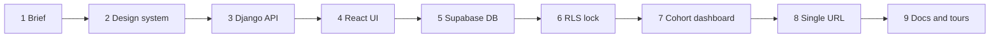

# Dev process

The whole build, in order. Each step links to what it produced.

1. **Brief** - UI brief for Google Stitch: black-and-white, Vercel meets Notion. Two roles: student and supervisor. Signature element: the commit timeline.
2. **Design system** - tokens in `frontend/src/styles.css`: hairline borders, 6px/8px/4px radii, only colour is 8px status dots. See [[Decisions]].
3. **Django API** - models, analyzer, views, JWT login. See [[Architecture]], [[Data-Model]], [[Scoring]].
4. **React UI** - login, dashboard, project detail, courses and rubric.
5. **Supabase** - `DATABASE_URL` points Django at Supabase Postgres; `python manage.py migrate` builds the tables.
6. **RLS lock** - `supabase/schema.sql` locks every table from the public anon key. See [[Supabase-Security]].
7. **Cohort dashboard** - supervisor table, distribution chart, compare, CSV.
8. **Single URL** - Django serves the built React app, so everything lives on one address. See [[Decisions]].
9. **Docs and tours** - this folder and `.tours/`.
10. **Nirvana release** - rebrand, tasks + AI requirements check ([[AI-Analysis]]), project management, limits, notifications, settings, help, toasts, fixed side nav, mobile drawer.

## Bugs found while building
- Lookups crashed with HTTP 500 instead of 404 -> fixed with `get_object_or_404`. See [[Troubleshooting]].
- Migrations cannot serialise `lambda` defaults -> replaced by named functions.

## Next
See [[Roadmap]].
