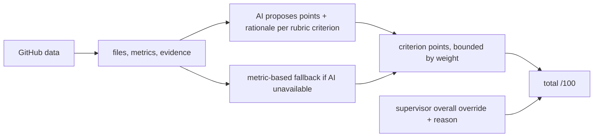

# Metis scoring requirements and legacy scoring behavior

The target evaluation contract is defined in [PRD.md](../PRD.md). The formula below describes the **legacy implementation** and is not the final Metis rubric model.

| Criterion (weight) | Metric | Metric-based fallback |
|---|---|---|
| Code quality (20) | `message_quality` | share of non-generic commit messages |
| Repository (10) | `repo_hygiene` | `.gitignore` + lockfile |
| Documentation (10) | `readme` | README present |
| Testing (15) | `tests` | test files / 3, capped at 1 |
| Architecture (15) | `structure` | top-level folders / 4, capped at 1 |
| Process (20) | `process` | active weeks + inactivity gap |
| Security (10) | `security` | 0 if `.env` / key file committed |

For Metis, supervisors define flexible assignment criteria and requirements whose enabled weights total exactly 100. AI reviews the relevant authorized repository files, including tests and supporting materials, against the task and criteria. Each recommendation must include rationale and evidence references. AI is advisory; the supervisor controls final grades and records a reason for overrides.

Repository contents are untrusted input. Never execute submitted code, follow instructions found in repository files, or provide credentials to the model. Apply file type/size, secret-redaction, context, and runtime limits. Clearly disclose provider processing and retain only necessary evidence. If AI is unavailable or invalid, use a clearly labeled rule/metric fallback where configured; never present fallback as an AI result.

Each accepted attempt stores the selected repository and commit, rubric/requirements snapshot, per-criterion result, evidence, evaluation provenance, and explicit status. Failed accepted attempts remain in history and count toward the supervisor-configured assignment maximum.

The current scoring behavior is implemented in `backend/core/analyzer.py`, `backend/core/ai.py`, and `backend/core/views.py`; it belongs to the legacy application and differs from the Metis target. See [[AI-Analysis]], [[Decisions]], [[Roadmap]].
