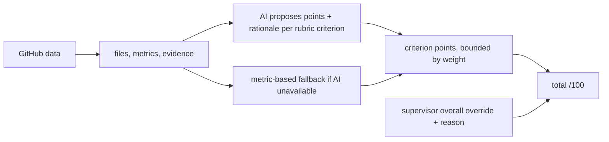

# Scoring

| Criterion (weight) | Metric | Metric-based fallback |
|---|---|---|
| Code quality (20) | `message_quality` | share of non-generic commit messages |
| Repository (10) | `repo_hygiene` | `.gitignore` + lockfile |
| Documentation (10) | `readme` | README present |
| Testing (15) | `tests` | test files / 3, capped at 1 |
| Architecture (15) | `structure` | top-level folders / 4, capped at 1 |
| Process (20) | `process` | active weeks + inactivity gap |
| Security (10) | `security` | 0 if `.env` / key file committed |

When an AI provider is configured, it reviews the gathered repository files, analyzer metrics, and evidence against each course rubric criterion. It recommends points from 0 to that criterion's weight and provides a rationale that cites available evidence. The recommendation is visible to both the student and supervisor and becomes the automatic criterion score; it is not an authoritative judgment.

If the provider is unavailable or returns invalid data, the existing metric-based fallback above supplies the automatic criterion scores. Supervisors can override individual criteria with a reason or set an overall grade override with a reason. The overall override takes precedence over the criterion total until reset.

Task requirements are checked in the same AI review when present, but are separate from the rubric score. Code: `backend/core/analyzer.py`, `backend/core/ai.py`, and `backend/core/views.py`. See [[Decisions]], [[Roadmap]].
